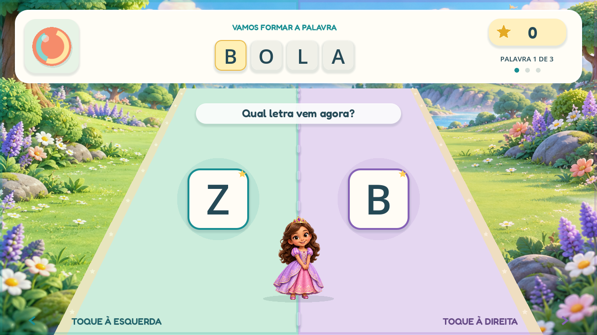

# Aventura das Letras

Jogo de alfabetização 2D para tablets Android. A criança escolhe uma princesa, um ursinho ou um cavaleiro e completa palavras coletando a próxima letra em uma corrida vertical.



## Versão atual

- Pista em perspectiva, com movimento de cima para baixo.
- Toda a metade esquerda ou direita responde ao toque, incluindo o cabeçalho e as margens; a linha central tem uma pequena faixa neutra para evitar erros ambíguos.
- Letras grandes, palavra completa como pista e marcação das letras já coletadas.
- Personagens e cenário ilustrados, salto ao coletar, estrelas, partículas e comemoração de palavra completa.
- Trilha suave e efeitos musicais originais, reproduzidos offline.
- Um toque é aceito por animação; não responder oferece outra oportunidade sem registrar erro.
- Conteúdo público genérico: BOLA, CASA e PATO.

O editor de conteúdo, as gravações de fonemas, a progressão adaptativa, os volumes separados, a redução de efeitos e o instalador Android ainda fazem parte das próximas etapas.

## Abrir no computador

1. Importe `game/project.godot` no [Godot 4.7.2 Standard](https://godotengine.org/download/archive/4.7.2-stable/).
2. Execute com **F5**.
3. Escolha um personagem. Durante a corrida, clique ou toque em qualquer altura da metade correspondente à letra.
4. A tecla **M** liga ou desliga o áudio completo no computador.

A direção da corrida é vertical; a tela continua em formato paisagem para deixar as duas áreas amplas. A validação de alcance e ritmo no tablet real ainda está pendente.

## Documentos e verificação

- [Requisitos públicos](docs/REQUISITOS-PUBLICOS.md)
- [Plano de desenvolvimento](docs/PLANO-DE-DESENVOLVIMENTO.md)
- [Arte, prompts, áudio e licença da fonte](docs/ARTE-E-AUDIO.md)
- [Pacotes locais de personagens](docs/PERSONAGENS-LOCAIS.md)

Teste de lógica e acessibilidade no Godot:

```text
godot --headless --path game --script res://tests/smoke.gd
```

Capturas reais de seleção, corrida, coleta, progresso e conclusão, com janela gráfica:

```text
godot --path game --script res://tests/visual_preview.gd -- --output-dir=CAMINHO_ABSOLUTO
```

## Privacidade

Fotos, gravações, nomes particulares, PINs e chaves de assinatura ficam fora do repositório público. O conteúdo personalizado será salvo no armazenamento local do aplicativo.
