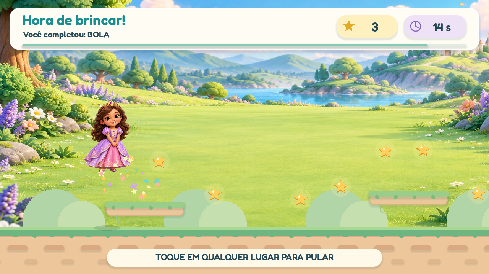

# Corrida bônus de plataforma (v0.3)

A cada palavra completa, o jogo mostra a grafia, pronuncia a palavra e comemora por 1,8 segundo. Em seguida, abre uma corrida de plataforma de **15 segundos**, com o personagem escolhido para a partida.

## Controle e recompensa

- O cenário se move automaticamente para a esquerda, enquanto o personagem corre para a direita.
- Um toque ou clique em qualquer parte da tela provoca um salto. A barra de espaço também funciona no computador.
- O caminho é contínuo, com plataformas baixas e estrelas para coletar.
- Não há buracos, vidas ou penalidade por deixar uma estrela passar.
- Os 15 segundos terminam com ou sem toques; nenhuma pontuação é exigida para voltar às letras.
- As estrelas do bônus são separadas dos acertos de leitura.
- O último bônus ocorre antes da tela de conclusão da partida.

Há 0,24 segundo de antecipação de toque antes de aterrissar e 0,12 segundo de tolerância depois de sair de uma plataforma. Toques repetidos no ar não geram saltos adicionais. Essas tolerâncias atendem ao controle de um único toque e devem ser observadas no tablet real.

## Personagens

O ursinho corre com mais balanço e pequenos pulos; a princesa tem um movimento leve de saia e trilha de brilho; o cavaleiro tem passadas mais firmes. Os três podem saltar. A animação deforma uma malha simples do atlas existente e conserva o rosto, o traje e os nomes de pacotes locais.

## Implementação e verificação

A física está em `game/bonus_run.gd`. O fluxo é `PLAY → WORD_DONE → BONUS → PLAY`, ou `SESSION_DONE` depois da última palavra. A nova fase não altera a palavra já concluída.

O teste `game/tests/bonus.gd` cobre a duração de 15 segundos, término sem toque, salto único, aterrissagem em plataforma, antecipação de toque, tolerância de borda, coleta única e quadros lentos. O teste de fluxo cobre o prêmio de todas as palavras e o retorno automático.

O script de prévia renderiza o bônus dos três papéis. Capturas com personagens locais ficam fora da documentação pública. O parâmetro `--generic-characters` gera imagens somente com o conjunto genérico.

## Próxima observação no tablet

Observar se o tempo de salto e a corrida estão confortáveis, se a instrução por voz é suficiente e se o retorno à próxima palavra fica claro. O painel de responsáveis poderá oferecer ajuste da duração ou desativação do bônus quando for construído.
