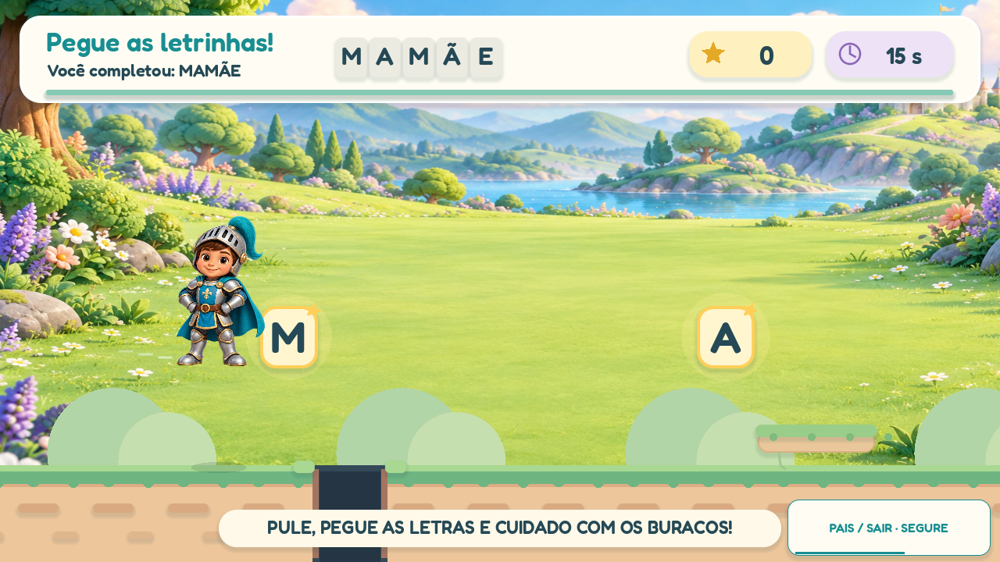
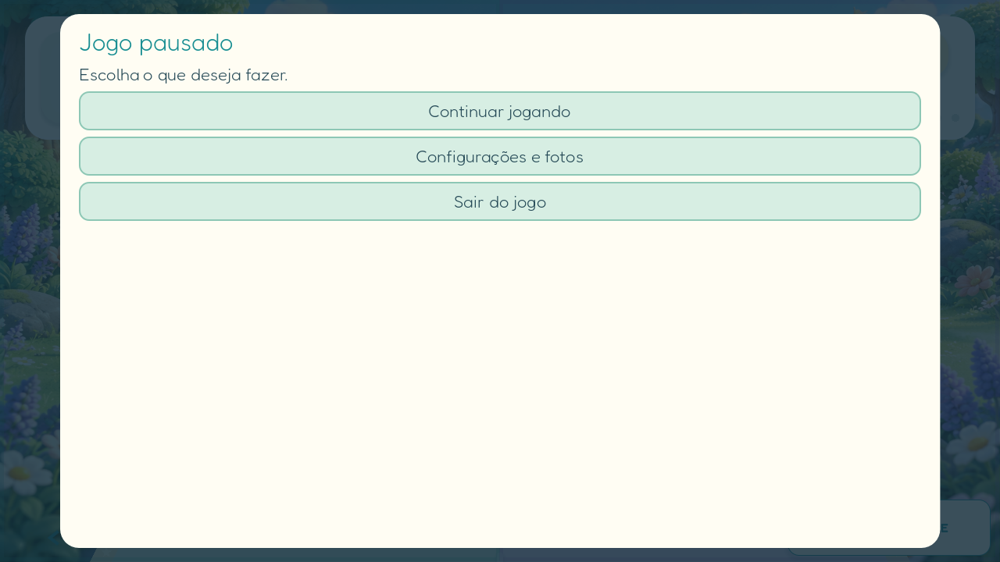

# Auditoria do fluxo — versão 0.4.1

## Problemas encontrados

- O toque para escolher um personagem desviava para autenticação e configurações quando a fixação estava desligada, mesmo com o aparelho já configurado.
- O início pendente não era retomado automaticamente depois da confirmação do Android.
- O acesso ao responsável durante a partida dependia do botão Voltar/gesto do sistema, difícil de executar com a tela fixada.
- A saída aguardava um intervalo fixo de 350 ms antes de fechar, sem conferir se o Android já havia liberado a tela.
- O bônus tinha efeitos de coleta, mas não encaminhava a identidade da letra ao narrador.

## Fluxo atual

| Ação | Resultado |
| --- | --- |
| Primeira abertura sem PIN | Criar e confirmar o PIN; configurar a proteção do tablet. |
| Abrir com perfil já configurado | Escolher personagem. |
| Escolher personagem com fixação ativa | Começar a leitura diretamente. |
| Escolher personagem com proteção configurada e fixação desligada | Confirmar o aviso de fixação do Android; começar com o personagem escolhido, sem outro PIN ou desvio às configurações. |
| Cancelar a fixação | Voltar à seleção de personagem, sem reabrir o PIN. |
| Segurar **PAIS / SAIR · SEGURE** por 1,2 segundo | Pausar e pedir PIN; um dedo, sem combinação dos botões físicos. |
| Confirmar PIN durante a partida | Menu curto: **Continuar jogando**, **Configurações e fotos**, **Sair do jogo**. |
| Escolher Sair do jogo | Solicitar liberação nativa e fechar após o Android confirmar que a fixação terminou. |
| Android não confirma a liberação em 3 segundos | Manter o menu autenticado e permitir tentar sair novamente, sem repetir o PIN. |

A área de segurar fica no canto inferior direito durante a partida e tem indicador de progresso. Um toque breve nessa mesma região continua sendo uma escolha de letra ou um pulo. Um deslocamento grande do dedo cancela a tentativa de abrir o menu. Na seleção, o botão **Responsáveis** continua abrindo o pedido de PIN com um toque.

As configurações aparecem quando o responsável as escolhe ou quando falta preparar a proteção do aparelho. O PIN do jogo e a exigência de senha do Android ao desafixar continuam ativos.

A integração usa a liberação oferecida pelo próprio Android: [Activity.stopLockTask](https://developer.android.com/work/dpc/dedicated-devices/lock-task-mode#stop_lock_task_mode). O gesto do sistema pode continuar existindo como alternativa do aparelho, mas não é necessário para a saída pelo menu do jogo.





## Fala das letras no bônus

Cada coleta produz a letra exata, incluindo acentos e repetições. A primeira captura dá prioridade à letra sobre a instrução introdutória; as seguintes entram em fila. O Android usa a fila nativa do Godot. No Windows, cada WAV termina antes de o próximo começar, conservando a solução que evita o bloqueio do backend de voz do sistema. A pausa e o silêncio cancelam a fila. A transição de resultado dá tempo para encerrar as falas, com limite de espera para manter a partida responsiva.

## Verificação

- Fluxo simulado: início sem novo PIN, preservação de personagem, cancelamento, menu compacto, toque breve, comando por um dedo, liberação atrasada e falha de liberação.
- Leitura e bônus: testes anteriores continuam passando.
- Áudio real no Windows: quatro letras coletadas no mesmo quadro geraram quatro reproduções completas e ordenadas.
- Inspeção visual: acesso durante leitura/bônus, progresso do comando e menu compacto.
- A confirmação de fixação/liberação e a fala no tablet físico ainda precisam ser conferidas no aparelho.

```text
godot --headless --path game --script res://tests/family_and_parent.gd
godot --headless --path game --script res://tests/smoke.gd
godot --headless --path game --script res://tests/bonus.gd
# Com janela e voz real do Windows:
godot --path game --script res://tests/bonus_voice_windows.gd --minimized
```
