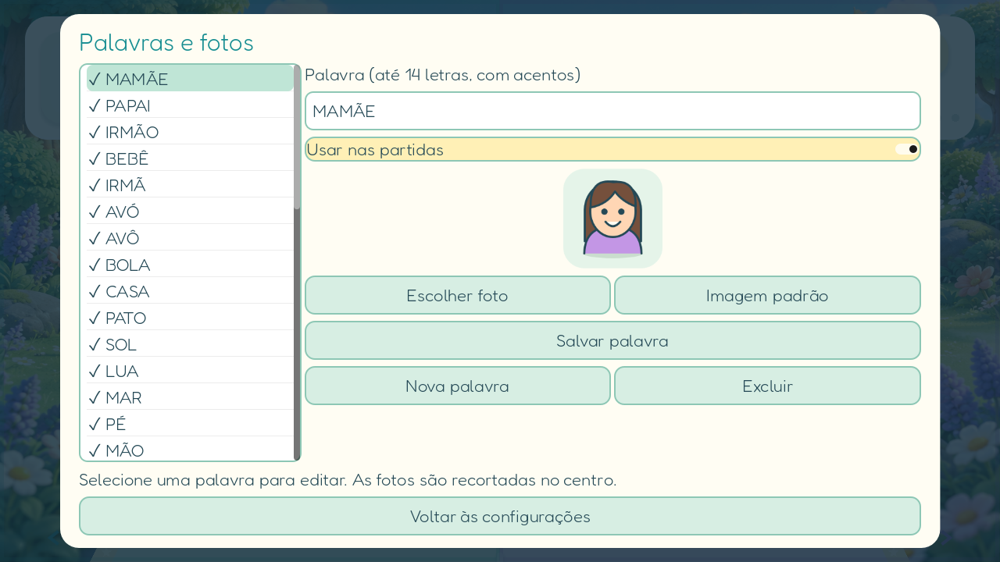

# Palavras, fotos e proteção de saída — v0.4

## Conteúdo inicial

O catálogo público tem 42 palavras com ilustrações, começando por familiares e palavras curtas: MAMÃE, PAPAI, BEBÊ, IRMÃO, IRMÃ, AVÓ, AVÔ, BOLA, CASA, PATO, SOL e LUA. Também há objetos, animais, frutas e palavras como PRAIA, ESCOLA e ESTRELA. O pacote privado pode acrescentar nomes próprios antes do catálogo genérico sem publicá-los no GitHub.

Cada rodada usa seis palavras habilitadas. Ao terminar a rodada, o próximo bloco do catálogo fica para a rodada seguinte; a posição é salva no aparelho. As duas alternativas de letra continuam variando de lado. As palavras aceitam até 14 letras maiúsculas, incluindo os acentos do português.



## Configuração pelo responsável

Na primeira abertura, crie e confirme um PIN de seis números. Não há PIN padrão. O mesmo PIN abre a área dos responsáveis e autoriza a saída pelo aplicativo.

- Na seleção de personagem, toque em **Responsáveis**.
- Durante a partida, use **Voltar** no Android ou **Esc** no computador. A partida pausa e pede o PIN.
- Em **Palavras e fotos**, selecione uma palavra, edite sua grafia, habilite/desabilite ou exclua. Pelo menos uma precisa permanecer habilitada.
- Use **Nova palavra**, digite o nome e salve antes de escolher a foto.
- **Escolher foto** abre o seletor do sistema. Uma cópia central quadrada de 512 × 512 é salva como JPEG no armazenamento privado do aplicativo. O original não é modificado. A foto substitui a ilustração durante a leitura e na comemoração.
- **Imagem padrão** remove a cópia associada e restaura a ilustração.
- Para sair, entre com o PIN e use **Liberar e sair do jogo**.

O perfil, o PIN com salt e resumo criptográfico e as cópias das fotos ficam em `user://family/`. O PIN não é guardado em texto. Cinco tentativas incorretas bloqueiam novas tentativas por 30 segundos durante essa execução. A troca de PIN exige acesso à área já autenticada. A exportação/importação do perfil entre aparelhos e a gravação de fonemas continuam pendentes.

## Fixação no Android: etapa necessária

O PIN do jogo protege suas telas e o comando de saída. Os botões Home/Recentes e o gesto de desafixar são controlados pelo Android. Para que a criança não saia por esses caminhos, o responsável precisa configurar a fixação e a senha do tablet:

1. Defina um PIN de bloqueio de tela no próprio tablet.
2. Ative **Fixação de app/tela** nas opções de Segurança.
3. Ative **Pedir PIN ao desafixar**, **Bloquear ao liberar** ou a opção equivalente do fabricante.
4. Volte ao jogo, entre na área dos responsáveis e confirme que ativou essa exigência nas opções do tablet.
5. Toque em **Voltar a brincar** e aceite o aviso de fixação apresentado pelo Android. A interface só retoma quando o sistema informa a fixação ativa.
6. Antes de entregar o tablet, teste Home, Recentes e o gesto de desafixar e confirme que pedem a senha do aparelho.

O botão **Segurança do tablet** abre as configurações do Android a partir da área autenticada. A leitura só começa no Android se há PIN do jogo, bloqueio seguro no aparelho, confirmação do responsável e fixação ativa. A confirmação do responsável é uma declaração de que ativou a opção; o aplicativo não altera nem comprova silenciosamente a configuração de senha ao desafixar.

A ponte usa `AndroidRuntime`, `JavaClassWrapper`, `startLockTask()` e `getLockTaskModeState()`. A liberação solicitada pela área autenticada usa `stopLockTask()`. A fixação comum pede confirmação do sistema. Um modo de quiosque administrado exige provisionamento próprio do aparelho e não é ativado automaticamente pelo APK.

Fontes oficiais: [Fixar e liberar telas](https://support.google.com/android/answer/9455138?hl=pt-BR), [Lock task mode](https://developer.android.com/work/dpc/dedicated-devices/lock-task-mode) e [integração Android do Godot](https://docs.godotengine.org/en/stable/tutorials/platform/android/javaclasswrapper_and_androidruntimeplugin.html).

## Verificação

```text
godot --headless --path game --script res://tests/family_and_parent.gd
```

Verifica catálogo, acentos, confirmação e persistência do PIN, limite de tentativas, pausa, pedido de autenticação ao fechar, edição e persistência da foto. Esses testes não substituem a verificação física da fixação, do seletor de fotos, da voz e dos gestos no tablet Positivo.
